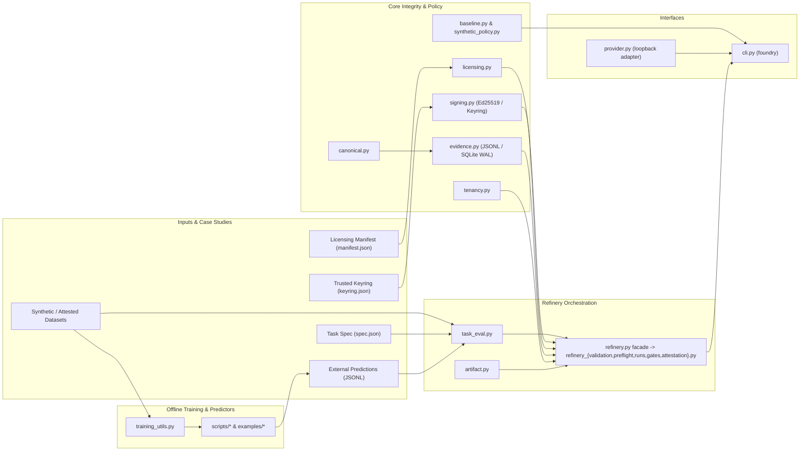
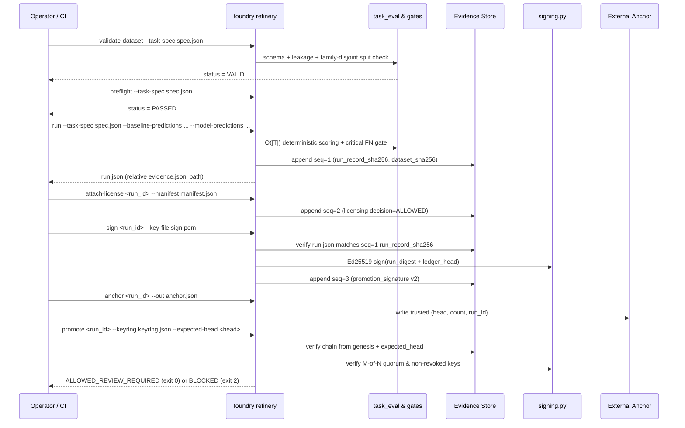

# Architecture, Contracts, and Threat Model

Foundry is an offline-first, evidence-gated model evaluation and lifecycle framework. Every evaluation run writes a canonical record into a tamper-evident hash chain, and promotion **fails closed** (exit code `2`) until dataset integrity, preflight safety, benchmarks, licensing allowlists, external anchoring, and cryptographic signatures all verify. Human review remains mandatory on every outcome (`review_rate = 1.0`, `coverage_automatic_decision = 0.0`, `financial_write = false`, `executed = false`).

---

## 1. System Architecture

---

## 2. Signed Promotion & Anchor Sequence

---

## 3. Module Boundaries

| Module | Responsibility | Does NOT Do |
|---|---|---|
| `canonical.py` | Single-pass canonical JSON serializer (`canonical`, `canonical_bytes`) & SHA-256 (`digest`); rejects non-string keys, circular refs, NaN/Inf, lone UTF-16 surrogates, normalizes `-0.0` to `0.0` | File I/O or network calls |
| `evidence.py` | Hash-chained append-only ledger (`JsonlEvidenceStore`, `SQLiteEvidenceStore`, `checkpoint`, `verify`), cross-platform file locking (`fcntl` / `msvcrt.LK_NBLCK`), `.ckpt` prefix checkpoints, `data_origin` policy gate | Remote consensus or rollback prevention without external anchor |
| `signing.py` | Fail-closed Ed25519 keygen/signing/verification (`SigningUnavailable`, `cryptography` extra), POSIX `0600` & Windows ACL enforcement (`GetNamedSecurityInfoW` / protected `SetNamedSecurityInfoW` DACL on `generate_keypair`), keyring quorum (`parse_keyring`, `load_keyring_policy`, `check_keyring_quorum`, strict entry allowlist) | Storing private keys in repo or embedding keys in run records |
| `licensing.py` | `evaluate()` SPDX allowlist (`Apache-2.0`, `MIT`, `BSD-3-Clause`, `CC0-1.0`, `OFL-1.1`), bounded `notes` (`<= 1024`), origin tiers (`synthetic`, `consented_pilot`, `redacted_eval` with explicit `governance_attestation`), optional local SHA-256 verification | Verifying legal truth of claims on remote hubs |
| `tenancy.py` | `TenantContext` validation, `authorize_run`, and `scope_ledger_query` fail-closed isolation helpers | Production identity/SSO authentication |
| `baseline.py` | Deterministic integer minor-unit reconciliation baseline, allowlist tool verifier (`verify_trace`), 22-case `evaluate_agents()`, synthetic dataset/split/eval | Trained ML inference or autonomous writes |
| `synthetic_policy.py` | Deterministic integer arithmetic gate (`assess`, `assess_with_suggestion`) backed by `canonical.digest` that untrusted model suggestions cannot override | Financial writes or execution |
| `task_eval.py` | Frozen task-spec validation (`validate_spec`), traversal-free path checks, group-disjoint splits, single-pass `score_predictions`, confusion matrix, per-family breakdown, calibration/bootstrap/McNemar | Running external models directly |
| `artifact.py` | Content-addressed local artifact store (`add_artifact`, `verify_artifact`, `get_artifact_path`, `list_artifacts`, `sha256_file`) | Remote model registry or cloud object storage |
| `refinery.py` + `refinery_*.py` | Modular orchestration (`types.py`, `validation`, `preflight`, `runs`, `gates`, `attestation`) behind `refinery` facade (`_code_digest` across package `.py`, `secrets.token_hex(6)`, `verify_bundle`) | Auto-deploying models without human sign-off |
| `provider.py` | Opt-in loopback HTTP adapter (`probe`, `predict`, `suggest`, `predict_batch`, `_DeadlineGuard`, `CircuitBreaker`, `audit_sha256`, `latency_ms`) with `UNAVAILABLE` fail-closed fallback | Heuristic substitution on provider error |
| `training_utils.py` | Shared offline preflight (`verify_private_dir`, `available_ram_bytes`, `acquire_training_lock`), pinned snapshot/Git-blob verification, `auto_map` rejection, `model_registry`, padded micro-batching, `LabelPrefixTrie`, training adapter hooks | Hub downloading or production serving |
| `cli.py` | `foundry` entrypoint, structured exit codes (`0`/`1`/`2`), `--json-errors`, subcommands for `refinery`, `provider`, `registry`, `doctor`, `demo`, `eval`, `policy-demo` | Silent fallback on invalid inputs |

---

## 4. Threat Model & Trust Boundaries

| Component | What It Protects Against | Residual Limitation / Mitigation |
|---|---|---|
| **Evidence Ledger** (`evidence.jsonl` / SQLite WAL) | Post-write tampering, field edits, sequence gaps, or prefix truncation caught via `verify()` / `inspect` from `GENESIS` | A local attacker with filesystem write access could replace *both* the ledger and `run.json` with an earlier valid state (**rollback attack**). Mitigate via **External Anchor**. |
| **`run.json`** | Stores evaluation outputs and provenance pointers using portable relative `"evidence.jsonl"` (and safely resolves `root_dir / "evidence.jsonl"` for cloned legacy runs, rejecting paths escaping `root_dir`) | Pre-sign edits to `thresholds`, `baseline_must_improve`, or `model_manifest` could mislead a signer if unchecked. Mitigated because `sign_run` verifies `run.json` against the seq-1 `run_record_sha256` before signing. |
| **Keyring** (`keyring.json`) | Limits trust to pinned Ed25519 public keys, enforces optional `key_id`, `role` requirements, `revoked_at` exclusions, and `required_signatures` M-of-N quorum | Compromised private keys before revocation can still produce valid signatures. Keep private keys out of the repository (mode `0600` on POSIX, restricted ACLs on Windows) and rotate/revoke promptly. |
| **External Anchor** (`anchor` / `--expected-head`) | Detects full-directory rollback and split-brain ledger tampering by comparing live head & count against an out-of-band checkpoint | Requires storing the anchor record outside the mutable `--output-root` (e.g., CI artifact, release tag, or append-only audit log). |
| **Signatures vs. Ground Truth** | Cryptographically binds the canonical run record and ledger head (including prior `model_licensing_manifest` evidence) | A signature proves evidence completeness at signing time; it does **not** prove weights were actually executed as claimed, that license metadata is legally accurate, or that synthetic accuracy transfers to pilot data. |

---

## 5. Key Module Contracts

### 5.1 `task_eval.py`
- **Spec Contract (`validate_spec`):** Requires `schema_version == "1.0"`, non-space `task_id` (1–64 chars), `description` (<= 512 chars), 2–64 unique clean `labels`, `thresholds` with `macro_f1_min` in `[0.8, 1.0]` (plus optional thresholds such as `critical_fn_rate_max`, `per_class_recall_min`, `invalid_output_rate_max`, `latency_p95_ms_max`), boolean `baseline_must_improve`, integer `split_seed`, bounded `notes`, `model` pinning `{base_model_id, revision, adapter_sha256, adapter_name}`, and relative traversal-free `dataset_path` (rejecting `/`, `\`, `..`, and drive letters like `C:`).
- **Scoring Contract (`score_predictions`):** Validates every prediction row is a `dict` with exact ID coverage (no missing, duplicate, or extra IDs), scores in a single `O(|T|)` pass, reports per-class precision/recall/F1/support, `macro_f1`, `accuracy`, `confusion_matrix`, `critical_false_negative_rate` (`null` when `critical_total == 0`, blocking promotion), and optional confidence calibration (`ece`, `brier`), abstention, latency p95, bootstrap confidence intervals, and McNemar significance helpers.

### 5.2 `signing.py`
- **Fail-Closed Backend:** Uses `cryptography` (`signing` extra). When absent, `backend_available()` returns `False`, `sign` raises `SigningUnavailable` / errors out, and `promote` blocks with `cryptographic_promotion_signature`.
- **Key Security:** `generate_keypair` refuses to overwrite existing keys; private keys enforce owner-only `0600` (`stat.S_IMODE(...) & 0o077 == 0`) on POSIX (`os.name == "posix"`) and Win32 `GetNamedSecurityInfoW` DACL verification on Windows (`os.name == "nt"`), rejecting NULL DACLs or broad SIDs. On Windows, `generate_keypair` applies a protected owner-only DACL (owner + `SYSTEM` + `Administrators` via `SetNamedSecurityInfoW`) so keys generated under directories with inherited broad ACEs remain valid.
- **Signature Binding (`v2`):** Signs `canonical({"version": 2, "run_id", "run_digest", "ledger_head"})`. Signatures written before `attach-license` cannot authorize promotion; legacy `v1` signatures are blocked.
- **Keyring Policy (`parse_keyring`, `load_keyring_policy`, `check_keyring_quorum`):** Backward-compatible with hex strings and `{label, public_key_hex}` entries while enforcing an explicit entry field allowlist (`{"public_key_hex", "key_id", "role", "revoked_at", "label"}`) so typos like `"revoked": true` fail closed, alongside `required_signatures` (default `1`) and `required_roles`.

### 5.3 `training_utils.py`
- **Offline Isolation:** Sets `HF_HUB_OFFLINE=1`, `TRANSFORMERS_OFFLINE=1`, `HF_HUB_DISABLE_IMPLICIT_TOKEN=1`, enforces `local_files_only=True`, `trust_remote_code=False`, `token=False`, and rejects Hugging Face `auto_map` entries in `config.json`.
- **Snapshot Verification:** Verifies `model.safetensors` SHA-256 (`sha_file`) and pinned Git blob SHA-1 IDs (`git_blob_sha1`, `verify_pinned_blobs`, `verify_snapshot`, `load_verified_snapshot`) for tokenizer/config artifacts before loading.
- **Cross-Platform Preflight & Locking:** `verify_private_dir` checks POSIX `st_uid == os.getuid()` and `0o077` mode bits on POSIX and owner/ACL safety via `advapi32`/`kernel32` on Windows; `available_ram_bytes` uses `os.sysconf` on POSIX (`vm_stat` fallback on macOS) and `GlobalMemoryStatusEx` via `ctypes` on Windows; `acquire_training_lock` coordinates concurrent writers (`fcntl` / `msvcrt`).
- **Training & Evaluation Helpers:** `model_registry` / `resolve_model_spec`, `select_device` (`cpu` default, optional `cuda`/`mps`/`dml`), `iter_micro_batches`, `grad_accum_window_size`, `should_step_grad_accum`, `collate_causal_lm_batch`, `collate_left_padded_prompts`, `LabelPrefixTrie` / `PrefixTrieLogitsProcessor`, `batched_greedy_generate`, and adapter hook types (`SFTAdapterHook`, `QLoRAAdapterHook`, `DPOAdapterHook`, `RLVRAdapterHook`).

---

## 6. Explicit Non-Goals & External Integrations

- **Settler & SAT-Frontier:** External repositories remain uncoupled; preserving Settler's deterministic minor-unit reconciliation, tenant authorization, proofpacks, and mandatory manual review is required before any integration.
- **Inference Serving:** Foundry provides an evaluation and promotion gate, not a production serving gateway (`model-tools` remains separate).
