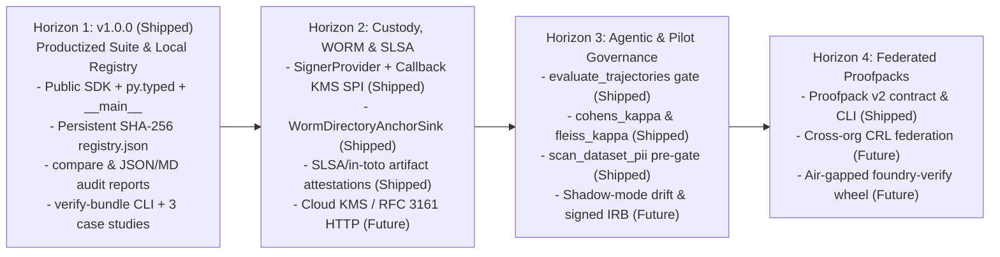

# Hardonian Foundry — Long-Term Product Roadmap

Hardonian Foundry is a fail-closed, offline-first refinery and promotion gate for specialized local models. Every release prioritizes **verifiable provenance**, **deterministic evaluation**, and **mandatory human review** over convenience or automation velocity.

---

## Permanent Non-Negotiable Invariants

Every milestone on this roadmap preserves the following invariants without exception:

| Invariant | Contract | Enforcement |
| --- | --- | --- |
| **Fail-Closed Promotion** | Incomplete evidence, broken hash chains, anchor mismatches, revoked keys, or missed quorums never promote. | Exit code `2`, `promoted: false`, `status: "BLOCKED"`. |
| **Mandatory Human Review** | Foundry never auto-deploys, never executes financial writes, and never approves autonomous decisions. | `review_required: true`, `coverage_automatic_decision: 0.0`, `financial_write: false`. |
| **Offline Verification Determinism** | Any third party with a bundle (`export-bundle`) and trusted public keys can verify runs offline. | Canonical JSON + SHA-256 + Ed25519 / standardized signature envelopes. |
| **Zero Silent Fallbacks** | Missing or failing providers never fall back to keyword/regex heuristics. | Explicit `UNDETERMINED` / `UNAVAILABLE` fail-closed records. |
| **Downstream Decoupling** | Foundry does not import settlement engines, financial ledgers, or live routing state (`Settler`, `SAT-Frontier`). | Schema-versioned read-only artifacts and bundles only. |

---

## Roadmap Overview



---

## Target Architecture Evolution (v1.x -> v2.0)

```mermaid
flowchart LR
    Run["Refinery Run\n(preflight + task_eval)"] --> Ledger["Tamper-Evident Ledger\n(evidence.jsonl / SQLite WAL)"]
    Ledger --> Reg["Fail-Closed Model Registry\n(registry.json + SHA-256)"]
    Ledger --> Bundle["Verification Bundle\n(dir / zip / tar.gz)"]

    subgraph Pluggable Trust Backends (Horizon 2+)
        KMS["SignerProvider SPI\n(Local Ed25519 / KMS / HSM / Sigstore)"]
        Anchor["AnchorSink SPI\n(anchor.json / RFC 3161 TSA / WORM Log)"]
    end

    KMS -. "Verifiable offline via public keyring" .-> Ledger
    Anchor -. "Anti-rollback head checkpoint" .-> Ledger
    Reg --> Gate["Human-Gated Promotion & Audit Report\n(ALLOWED_REVIEW_REQUIRED | BLOCKED)"]
    Bundle --> AirGap["Offline Auditor / Downstream Interop\n(Read-Only Proofpack)"]
```

---

## Horizon 1 — `v1.0.0`: Productized Suite & Fail-Closed Local Registry (Shipped)

**Goal:** Deliver a complete, cleanly packaged, strictly typed, cross-platform (`Linux`, `macOS`, `Windows`) developer suite with stable Python SDK and CLI interfaces.

- **Packaging & Developer Ergonomics**
  - PEP 561 `py.typed` marker and strict `mypy` type checking across all package modules.
  - Standard `python -m hardonian_foundry` entrypoint alongside the `foundry` console script.
  - Lazy optional dependencies so core verification and CLI tooling import cleanly without `[signing]` (`cryptography`) or `[train]` (`torch`) extras installed.
- **Persistent SHA-256 Model Registry (`registry.py`)**
  - Fail-closed model registration (`register_model`), discovery (`list_models`), lookup (`get_model`), promotion (`registry promote`), and full integrity verification (`verify_registry`).
  - Whole-file `registry_sha256` checksum, atomic temp-file writes, tenant isolation (`TenantContext`), and re-verification against each backing run's immutable ledger snapshot and signature gate.
- **Statistical Model Comparison & Compliance Reporting**
  - `compare_task_predictions` and `foundry refinery compare`: deterministic pairing on frozen test splits with McNemar paired tests, multi-seed bootstrap confidence intervals, and `macro_f1` / `accuracy` deltas.
  - `generate_audit_report` and `foundry refinery report`: deterministic JSON and Markdown human-review audit summaries for governance sign-off.
  - `foundry refinery verify-bundle`: standalone CLI verification for exported `dir`, `zip`, `tar`, and `tar.gz`/`tgz` verification bundles.

---

## Horizon 2 — `v1.1` to `v1.2`: Enterprise Key Custody, Remote Anchoring & Build Attestation

**Goal:** Remove single-operator PEM custody and local filesystem anchoring as production trust bottlenecks while keeping offline bundle verification zero-trust.

### `v1.1` — Pluggable Custody & Transparency Anchoring

1. **`SignerProvider` Service Provider Interface (`signing.py` & `trust_adapters.py`) — Core SPI & Subprocess KMS Shipped**
   - Shipped `@runtime_checkable class SignerProvider`, `LocalPemSignerProvider`, `CallbackSignerProvider`, and `SubprocessKmsSignerProvider` (`shell=False`, offline Ed25519 signature verification) plus `sign_run(..., signer=...)`.
   - Future work: first-party vendor cloud SDK packages (`hardonian-foundry-kms` for AWS/GCP/Azure KMS, PKCS#11 HSM, keyless OIDC Sigstore).
2. **External Anti-Rollback `AnchorSink` Integrations — Core SPI, WORM, RFC 3161 TSA & Object Lock Shipped**
   - Shipped `@runtime_checkable class AnchorSink`, `WormDirectoryAnchorSink`, `Rfc3161TsaAnchorSink`, `ObjectLockAnchorSink`, `anchor_run(..., sink=..., worm_dir=...)`, and CLI `foundry refinery anchor --worm-dir <dir>`.

### `v1.2` — Hermetic Execution & Artifact Lineage

1. **Supply-Chain Provenance for Weights & Datasets (`artifact.py`) — SLSA/in-toto Implemented**
   - Shipped `create_build_attestation` and `verify_build_attestation` plus CLI `foundry refinery artifact attest` and `verify-attestation` emitting SHA-256-sealed `https://in-toto.io/Statement/v1` + `https://slsa.dev/provenance/v1` JSON documents binding subject weights and materials.
   - Enforce pre-run artifact digest pinning and optional SPDX + license-text hashing inside content-addressed metadata.
2. **Reproducible Environment Attestations (`preflight`) — Planned**
   - Capture deterministic container / lockfile (`uv.lock` / `requirements.txt` hash) digests and GPU/CPU determinism flags during training runs for audit traceability.

---

## Horizon 3 — `v1.3` to `v1.5`: Agentic Trajectory Evaluation, Calibration Drift & Pilot Governance

**Goal:** Expand Foundry from single-turn classification specs to multi-step tool-using specialist models and governed real-world pilot calibration.

### `v1.3` — Multi-Turn & Tool-Use Task Specs — Core Trajectory Gate Implemented

- Shipped `evaluate_trajectories` (`task_eval.py`) enforcing `false_tool_execution_rate == 0.0`, tool allowlists/forbidden-tool checks, and traversal/control-character argument safety across multi-turn step lists.
- Integrated adversarial prompt-injection and jailbreak gate suites connected cleanly to the repository's `promptfoo` red-team test matrix.
- Planned: exact abstention / escalation accuracy metrics in `task_eval` schema `1.1`.

### `v1.4` — Continuous Calibration, Slicing & Multi-Rater Agreement — Kappa Implemented

- **Calibration & Slice Gates (Planned):** Track rolling calibration slices and subgroup/tenant slice minimum recall bounds over time windows inside promotion gates.
- **Human Agreement Benchmarks — Implemented:** Shipped `cohens_kappa` and `fleiss_kappa` (`task_eval.py`) to gate dual- and multi-rater adjudication sets aligned with [docs/dataset-card.md](dataset-card.md).
- **Shadow-Mode Drift Watchlists (Planned):** Automated scheduled comparison reports (`refinery compare` over time windows) without mutating live serving configs.

### `v1.5` — Consented Pilot & Privacy Verification Automation — Pre-Ingestion PII Scanner Implemented

- **Signed Consent Receipts — Shipped:** Added `create_consent_receipt` and `verify_consent_receipt` (`trust_adapters.py`) signing `governance_attestation` payloads with Ed25519 against a trusted keyring.
- **Pre-Ingestion PII & Canary Scanners — Implemented:** Shipped `scan_dataset_pii` (`task_eval.py`) blocking residual emails, US SSNs, IBANs, and API secret tokens before `consented_pilot` or `redacted_eval` ingestion without echoing sensitive text into logs.

---

## Horizon 4 — `v2.0`: Multi-Organization Federation & Downstream Proofpack Interop

**Goal:** Enable mutually distrustful organizations (model vendor, validator, auditor, operator) to verify specialized model promotions cleanly across organizational boundaries.

1. **Cross-Organization Threshold Keyrings (Planned)**
   - Extend quorum policies (`required_signatures`, `required_roles`) with organization namespaces, time-bounded delegation certificates, and CRL/revocation distribution feeds so no single entity can unilaterally forge promotion readiness.
2. **Air-Gapped Standalone Verifier Distribution (`scripts/foundry_verify.py`) — Reference Verifier Shipped**
   - Shipped `scripts/foundry_verify.py` (`proofpack`, `registry`, `bundle`) verifying `Proofpack v2` digests, anchor heads, Ed25519 keyrings, and `registry.json` integrity offline; standalone wheel packaging remains optional.
3. **Versioned Proofpack Contract for Downstream Consumers — Signed `Proofpack v2` Implemented**
   - Shipped `proofpack.py` (`build_proofpack`, `verify_proofpack`) and CLI `foundry refinery proofpack` / `verify-proofpack` emitting and verifying SHA-256-sealed + Ed25519-receipted `hardonian.foundry.proofpack.v2` JSON payloads (`--keyring`, `--expected-head`, `--consumers`) plus `compliance.py` regulatory control profiles (`eu-ai-act`, `sr-11-7`, `nist-ai-rmf`, `iso-42001`), HTML audit dossiers, `scaffold.py`, `schemas.py`, `importers.py`, and `mcp_tools.py`.

---

## Versioning, Compatibility & Exit Criteria

- **Semantic Versioning:** Public Python API (`hardonian_foundry.__all__`), CLI flags/exit codes (`0` OK, `1` validation/preflight/unavailable, `2` fail-closed block/input error), and JSON `schema_version: "1.0"` payloads remain backward compatible across all `v1.x` releases.
- **Fail-Closed Legacy Posture:** Legacy `v1` signature formats, un-anchored runs when `--expected-head` is supplied, and runs lacking SPDX license proof before signing remain permanently `BLOCKED` across all versions.
- **Horizon Promotion Criteria:** Every Horizon release must pass:
  1. Full cross-platform CI matrix (`Linux`, `macOS`, `Windows`) with Python `3.11+`, including zero-extra `no-signing-extra` smoke tests.
  2. Static analysis & security gates (`ruff`, strict `mypy`, `bandit`, `pip-audit`, secret scanning, and `promptfoo` red-team checks).
  3. Committed signed case-study replay verification proving zero regressions on historical audit bundles.
