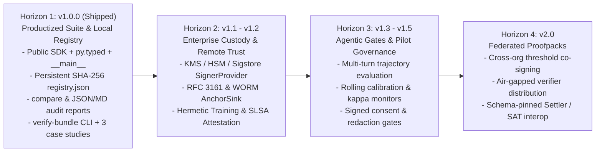

# Hardonian Foundry — Long-Term Product Roadmap

Hardonian Foundry is a fail-closed, offline-first refinery and promotion gate for specialized local models. Every release prioritizes **verifiable provenance**, **deterministic evaluation**, and **mandatory human review** over convenience or automation velocity.

---

## Permanent Non-Negotiable Invariants

Every milestone on this roadmap preserves the following invariants without exception:

| Invariant | Contract | Enforcement |
|---|---|---|
| **Fail-Closed Promotion** | Incomplete evidence, broken hash chains, anchor mismatches, revoked keys, or missed quorums never promote. | Exit code `2`, `promoted: false`, `status: "BLOCKED"`. |
| **Mandatory Human Review** | Foundry never auto-deploys, never executes financial writes, and never approves autonomous decisions. | `review_required: true`, `coverage_automatic_decision: 0.0`, `financial_write: false`. |
| **Offline Verification Determinism** | Any third party with a bundle (`export-bundle`) and trusted public keys can verify runs offline. | Canonical JSON + SHA-256 + Ed25519 / standardized signature envelopes. |
| **Zero Silent Fallbacks** | Missing or failing providers never fall back to keyword/regex heuristics. | Explicit `UNDETERMINED` / `UNAVAILABLE` fail-closed records. |
| **Downstream Decoupling** | Foundry does not import settlement engines, financial ledgers, or live routing state (`Settler`, `SAT-Frontier`). | Schema-versioned read-only artifacts and bundles only. |

---

## Roadmap Overview



---

## Target Architecture Evolution (v1.x -> v2.0)

```mermaid
flowchart LR
    Run["Refinery Run\n(preflight + task_eval)"] --> Ledger["Tamper-Evident Ledger\n(evidence.jsonl / SQLite WAL)"]
    Ledger --> Reg["Fail-Closed Model Registry\n(registry.json + SHA-256)"]
    Ledger --> Bundle["Verification Bundle\n(dir / zip / tar.gz)"]

    subgraph Pluggable Trust Backends (Horizon 2+)
        KMS["SignerProvider SPI\n(Local Ed25519 / KMS / HSM / Sigstore)"]
        Anchor["AnchorSink SPI\n(anchor.json / RFC 3161 TSA / WORM Log)"]
    end

    KMS -. "Verifiable offline via public keyring" .-> Ledger
    Anchor -. "Anti-rollback head checkpoint" .-> Ledger
    Reg --> Gate["Human-Gated Promotion & Audit Report\n(ALLOWED_REVIEW_REQUIRED | BLOCKED)"]
    Bundle --> AirGap["Offline Auditor / Downstream Interop\n(Read-Only Proofpack)"]
```

---

## Horizon 1 — `v1.0.0`: Productized Suite & Fail-Closed Local Registry (Shipped)

**Goal:** Deliver a complete, cleanly packaged, strictly typed, cross-platform (`Linux`, `macOS`, `Windows`) developer suite with stable Python SDK and CLI interfaces.

- **Packaging & Developer Ergonomics**
  - PEP 561 `py.typed` marker and strict `mypy` type checking across all package modules.
  - Standard `python -m hardonian_foundry` entrypoint alongside the `foundry` console script.
  - Lazy optional dependencies so core verification and CLI tooling import cleanly without `[signing]` (`cryptography`) or `[train]` (`torch`) extras installed.
- **Persistent SHA-256 Model Registry (`registry.py`)**
  - Fail-closed model registration (`register_model`), discovery (`list_models`), lookup (`get_model`), promotion (`registry promote`), and full integrity verification (`verify_registry`).
  - Whole-file `registry_sha256` checksum, atomic temp-file writes, tenant isolation (`TenantContext`), and re-verification against each backing run's immutable ledger snapshot and signature gate.
- **Statistical Model Comparison & Compliance Reporting**
  - `compare_task_predictions` and `foundry refinery compare`: deterministic pairing on frozen test splits with McNemar paired tests, multi-seed bootstrap confidence intervals, and `macro_f1` / `accuracy` deltas.
  - `generate_audit_report` and `foundry refinery report`: deterministic JSON and Markdown human-review audit summaries for governance sign-off.
  - `foundry refinery verify-bundle`: standalone CLI verification for exported `dir`, `zip`, `tar`, and `tar.gz`/`tgz` verification bundles.

---

## Horizon 2 — `v1.1` to `v1.2`: Enterprise Key Custody, Remote Anchoring & Build Attestation

**Goal:** Remove single-operator PEM custody and local filesystem anchoring as production trust bottlenecks while keeping offline bundle verification zero-trust.

### `v1.1` — Pluggable Custody & Transparency Anchoring
1. **`SignerProvider` Service Provider Interface (`signing.py`)**
   - Abstract key signing behind a uniform canonical prehash envelope so local Ed25519 PEMs, AWS KMS / GCP Cloud KMS / Azure Key Vault asymmetric keys, PKCS#11 HSMs, and keyless OIDC Sigstore bundles share one deterministic verification path.
   - Maintain offline verification: signatures carry public key/certificate chains verified against a pinned keyring (`keyring.json`), with zero runtime cloud calls required inside `refinery inspect` or `refinery verify-bundle`.
2. **External Anti-Rollback `AnchorSink` Integrations**
   - Extend `refinery anchor` beyond local `anchor.json` files to write-once external checkpoints:
     - RFC 3161 Time-Stamping Authority (TSA) signed tokens over `(ledger_head, count, run_record_sha256)`.
     - Cloud WORM storage backends (S3 Object Lock / GCS Bucket Lock) with append-only retention metadata.
     - Optional public or private transparency-log inclusion receipts (Rekor / Trillian style Merkle proofs).

### `v1.2` — Hermetic Execution & Artifact Lineage
1. **Supply-Chain Provenance for Weights & Datasets (`artifact.py`)**
   - Attach SLSA / `in-toto` style build statements linking base model commit SHAs, LoRA adapter artifacts, tokenizer configs, and dataset hashes to `run.json`.
   - Enforce pre-run artifact digest pinning and optional SPDX + license-text hashing inside content-addressed metadata.
2. **Reproducible Environment Attestations (`preflight`)**
   - Capture deterministic container / lockfile (`uv.lock` / `requirements.txt` hash) digests and GPU/CPU determinism flags during training runs for audit traceability.

---

## Horizon 3 — `v1.3` to `v1.5`: Agentic Trajectory Evaluation, Calibration Drift & Pilot Governance

**Goal:** Expand Foundry from single-turn classification specs to multi-step tool-using specialist models and governed real-world pilot calibration.

### `v1.3` — Multi-Turn & Tool-Use Task Specs
- Extend `task_eval.py` schema (`schema_version: "1.1"` backward compatible with `"1.0"`) with structured trajectory contracts:
  - Step-level tool argument schema validation and forbidden-tool refusal assertions (`false_tool_execution_rate == 0.0`).
  - Integrated adversarial prompt-injection and jailbreak gate suites connected cleanly to the repository's `promptfoo` red-team test matrix.
  - Exact abstention / escalation accuracy metrics when inputs lack required domain evidence.

### `v1.4` — Continuous Calibration, Slicing & Multi-Rater Agreement
- **Calibration & Slice Gates:** Track Expected Calibration Error (ECE), Brier score, and subgroup / tenant slice minimum recall bounds directly inside `task_eval` and promotion gates.
- **Human Agreement Benchmarks:** Compute Cohen's kappa and Fleiss' kappa across masked dual-rater adjudication sets (`docs/calibration-plan.md`), blocking promotion if model disagreement patterns spike on critical classes.
- **Shadow-Mode Drift Watchlists:** Read-only comparison reports (`refinery compare` over time windows) highlighting confidence shifts without mutating live serving configs.

### `v1.5` — Consented Pilot & Privacy Verification Automation
- **Signed Consent Receipts:** Upgrade `governance_attestation` from declarative metadata to Ed25519/KMS-signed organizational approvals referencing IRB/legal retention policies and redaction audits.
- **Pre-Ingestion PII & Canary Scanners:** Fail-closed dataset scanners checking for residual emails, account numbers, IBANs, SSNs, or canary secrets before any `consented_pilot` or `redacted_eval` dataset enters `evidence.jsonl`.

---

## Horizon 4 — `v2.0`: Multi-Organization Federation & Downstream Proofpack Interop

**Goal:** Enable mutually distrustful organizations (model vendor, validator, auditor, operator) to verify specialized model promotions cleanly across organizational boundaries.

1. **Cross-Organization Threshold Keyrings**
   - Extend quorum policies (`required_signatures`, `required_roles`) with organization namespaces, time-bounded delegation certificates, and CRL/revocation distribution feeds so no single entity can unilaterally forge promotion readiness.
2. **Air-Gapped Standalone Verifier Distribution (`foundry-verify`)**
   - Publish a minimal zero-heavy-dependency verifier package (`stdlib` + optional PyCA `cryptography`) capable of auditing any `export-bundle` archive, RFC 3161 anchor, and `registry.json` snapshot in locked-down compliance enclaves.
3. **Versioned Proofpack Contract for Downstream Consumers**
   - Freeze a read-only `Proofpack v2` JSON schema emitted by `export-bundle` / `generate_audit_report` for external consumers (`model-tools` routing allowlists, `Settler`, and `SAT-Frontier` audit trails), preserving clean one-way decoupling: downstream systems verify Foundry proofpacks without Foundry ever importing or mutating operational state.

---

## Versioning, Compatibility & Exit Criteria

- **Semantic Versioning:** Public Python API (`hardonian_foundry.__all__`), CLI flags/exit codes (`0` OK, `1` validation/preflight/unavailable, `2` fail-closed block/input error), and JSON `schema_version: "1.0"` payloads remain backward compatible across all `v1.x` releases.
- **Fail-Closed Legacy Posture:** Legacy `v1` signature formats, un-anchored runs when `--expected-head` is supplied, and runs lacking SPDX license proof before signing remain permanently `BLOCKED` across all versions.
- **Horizon Promotion Criteria:** Every Horizon release must pass:
  1. Full cross-platform CI matrix (`Linux`, `macOS`, `Windows`) with Python `3.11+`, including zero-extra `no-signing-extra` smoke tests.
  2. Static analysis & security gates (`ruff`, strict `mypy`, `bandit`, `pip-audit`, secret scanning, and `promptfoo` red-team checks).
  3. Committed signed case-study replay verification proving zero regressions on historical audit bundles.
